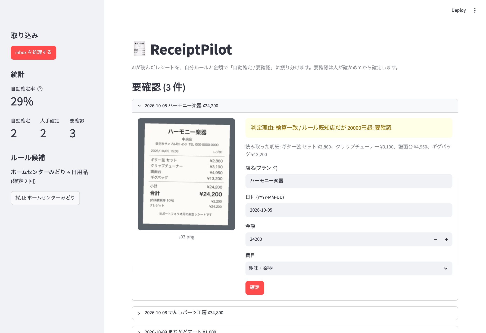
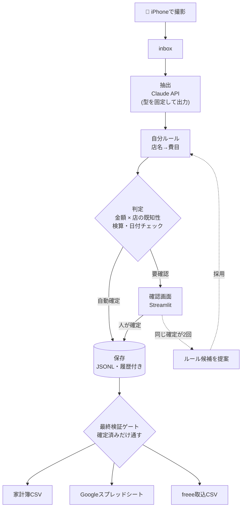

# ReceiptPilot 🧾

**レシートを撮るだけで、家計簿・会計ソフト用のデータになる。ただし、AIに任せきりにはしない。**

[](https://github.com/kiilab-tech/receiptpilot/actions/workflows/test.yml)


iPhoneで撮ったレシートを Claude API(画像を読めるAI)で読み取ります。そのうえで
**「自分で決めたルール」と「金額」**から、**自動で確定してよいもの**と**人が確認すべきもの**を振り分けます。
確認画面で直した結果はルールとして育つので、使うほど確認の手間が減っていきます。



<sub>※ 画面内のレシートはすべてポートフォリオ用に作成した架空データです。</sub>

---

## 解決したいこと

| よくある困りごと | ReceiptPilot の答え |
|---|---|
| レシートの手入力が続かない | 撮影 → フォルダに置くだけ。読み取りと費目の振り分けは自動 |
| OCRの読み間違いが、気づかないうちに帳簿へ混ざる | 自信のないものは**自動確定しない**。判定理由を添えて人に回す |
| AIの分類が自分の分類と合わない | **自分ルールがAIより常に優先**。直した結果がルール候補になる |
| 家計簿と会計ソフトで形式が違う | 家計簿CSV / Googleスプレッドシート / freee取込CSV に出力 |

## 30秒で試す(APIキー不要)

架空レシート7枚と、Mock の読み取り結果でひととおり動きます。

```bash
git clone https://github.com/kiilab-tech/receiptpilot.git && cd receiptpilot
python3 -m venv .venv && source .venv/bin/activate
pip install -r requirements.txt
python3 run.py demo
```

```text
s01.png: confirmed まちかどマート  ¥788    ['検算一致', 'ルール既知店 かつ 20000円以下: 自動確定']
s03.png: review    ハーモニー楽器  ¥24200  ['検算一致', 'ルール既知店だが 20000円超: 要確認']
s04.png: review    ホームセンターみどり中央店  ¥1628  ['必須項目欠落: 費目(自分ルールに無い店)']
s05.png: review    でんしパーツ工房  ¥34800  ['検算一致', '高額(34800円 > 30000円): 常に要確認']
s06.png: review    まちかどマート  ¥1000   ['検算不一致: 明細計800 (税90) != 合計1000']
...
```

確認画面を開くと、要確認の5件を原本画像と並べて確認・修正・確定できます。

```bash
RECEIPTPILOT_DATA=data/demo RECEIPTPILOT_EXTRACTOR=mock streamlit run app/streamlit_app.py
```

同じ未知の店(ホームセンターみどり)を2回確定すると、サイドバーに「ルールにしますか?」と候補が出ます。
採用すると、次からその店は自動確定に回ります。

## 仕組み



### 判定ルール(「迷ったら安全側」)

| 条件 | 判定 |
|---|---|
| 30,000円を超える | 常に要確認(金額の絶対防衛線) |
| 自分ルールに載っている店 かつ 20,000円以下 | 自動確定 |
| ルールに無い店 | 要確認(費目は人が決める。決めた結果がルール候補に育つ) |
| 検算が合わない(内税: 明細計＝合計、外税: 明細計＋税額＝合計、のどちらでもない) / 日付が不正・未来 / 金額0以下 / 項目が欠けている | 常に要確認 |

判定理由は必ず記録し、確認画面にそのまま表示します(なぜ要確認なのかが分かる)。

## 設計で工夫した点

- **誤った自動確定 1件は、要確認 100件より害が大きい**という前提で設計しました。
  しきい値は「金額 × その店を知っているか」の2軸です。一律の信頼度で切ると、
  コンビニの500円とホームセンターの2万円を同じ基準で扱ってしまうためです。
- **最終検証ゲートを基底クラスに固定しました。** 開発中、項目が全部埋まった未確定データが
  CSVに出てしまう不具合を起こしました。その再発防止として、すべての出力形式が必ず通る
  `Adapter.validate` で「確定済みか」を検査し、個別の出力形式からは省略できない構造にしています。
- **AIの出力は型で縛っています。** Claude API の tool 定義で項目と型を固定し、自由文を解析しない
  方式です。読めない項目は推測させず null にして、要確認に回します。
- **人の判断がルールに育ちます。** 同じ「店→費目」が2回確定されたらルール候補として提案します。
  ただし自動追加はせず、採用するかどうかも人が決めます。
- **現場で止まらない作りにしました。**
  - 1枚の読み取りに失敗しても全体は止めません。失敗分は保存しないので、次回の実行で自動的に再挑戦します。
  - 同じ画像はハッシュで判定し、二重に処理しません。
  - iPhone写真(HEIC・4000px級)は、回転補正と縮小をしてから送信します。
- **出力も安全に。** Excelで文字化けしないようBOM付きCSVで出力します。また店名が `=` などで
  始まる場合は数式として実行されないよう無害化します(CSVインジェクション対策)。

## 実物レシートでの検証

手元の実物レシート4枚(スーパー2・コンビニ1・ガソリンスタンド1。うち3枚が外税)を読み取り、
人が作った正解データと突き合わせました(`python3 tools/evaluate.py 正解データ.json`)。

| 項目 | 正解数(4枚) |
|---|---|
| 日付・合計金額・支払方法・店名 | 各 4/4 |
| 明細(件数・金額) | 4/4 |
| 税額 | 3/4 |

- 検証で見つかった問題を直しました。具体的には、AIが返すハイフンの文字の違い、外税レシートの検算、
  明細への小計行の混入、AIのメモへの個人情報の記載の4点です
- 税額を読み違えた1枚は**検算で検知して要確認に回り、誤った自動確定は0件**でした
- 詳細は [要件定義書 7章](docs/要件定義書.md) にまとめています。レシートの画像は公開していません

## 技術スタック

`Python 3.11+` `Claude API (Vision + tool use)` `Streamlit` `Pillow / pillow-heif` `PyYAML`
`pytest` `GitHub Actions` `Google Apps Script`

## テスト

```bash
pip install -r requirements-dev.txt
pytest -q
```

APIキーなしで、次の内容を自動テストしています(GitHub Actions で Python 3.11〜3.13)。

- 取込 → 抽出 → ルール → 判定 → 保存 → 出力 の全段
- しきい値の境界値(3,000 / 20,000 / 30,000円の「以下」と「超」)
- 不正な日付・未来日付・0円以下・検算不一致が要確認になること(外税の検算を含む)
- 実物レシートで見つかった問題の再発防止(ハイフンの文字の違い、小計行の混入)
- 未確定データがどの出力形式からも出ないこと(最終検証ゲート)
- ルールの優先順位(完全一致 > 前方一致 > 部分一致)と、全角/半角ゆれの吸収
- 学習ループ(人手確定 → ルール候補 → 採用 → 自動確定率の上昇)
- 画像の縮小・回転補正、1枚の失敗で全体が止まらないこと、CSVの安全性

## 実際のレシートで使う

```bash
export ANTHROPIC_API_KEY=...        # 実行するシェルで設定(ファイルに保存しない)
cp ~/Pictures/receipt*.HEIC data/inbox/
python3 run.py process
streamlit run app/streamlit_app.py
python3 run.py export kakeibo       # data/out/kakeibo.csv
python3 run.py export freee         # data/out/freee_import.csv
```

- iPhone からの自動転送: [tools/iphone_shortcut.md](tools/iphone_shortcut.md)
- Googleスプレッドシートへの書き込み: [tools/gas/kakeibo_sheet.gs](tools/gas/kakeibo_sheet.gs)
- 自分ルール: [masters/payee_rules.yaml](masters/payee_rules.yaml) / 費目と freee 勘定科目の対応: [masters/categories.yaml](masters/categories.yaml)

## プライバシーとコスト

- 画像・データはすべて手元のPCに保存します。外部へ送るのは、読み取りのときの画像1枚だけです(Anthropic API)。
- サーバーを常時動かす必要はありません。
- API費用の目安は、1枚あたり数円程度です(claude-sonnet-4-6。`extract.py` で低コストのモデルへ切り替えられます)。

## 現状と今後

- ✅ コア機能・確認画面・3種類の出力・自動テスト・デモ
- 🔄 実物レシートでの精度評価(4枚で検証済み。かすれ・高額・値引きのあるレシートで続ける予定)
- 📋 freee 連携の本番検証、事業者向け要件(電子帳簿保存法の保存要件、勘定科目の見直し)

詳しい要件は [docs/要件定義書.md](docs/要件定義書.md) にまとめています。

## 構成

```text
src/receiptpilot/
  schema.py      共通データ形式(抽出結果 / 帳簿の1行)
  extract.py     Claude API での読み取り・画像の前処理・Mock
  rules.py       自分ルール・店名の正規化
  judge.py       自動確定 / 要確認 の判定
  learn.py       確定結果からルール候補を作る
  store.py       保存(追記型・履歴が残る)
  pipeline.py    取込 → 抽出 → ルール → 判定 → 保存
  paths.py       データ置き場の切り替え(本番 / デモ)
  adapters/      家計簿CSV / GAS / freee(共通の最終検証ゲート付き)
app/streamlit_app.py  確認画面
samples/              デモ用の架空レシート(tools/make_samples.py で生成)
tests/                自動テスト
```

## 作者

**山本 喜一郎 | Kiichiro Yamamoto** — 組込み開発30年以上の経験を土台に、AI・画像処理・業務自動化で
現場の困りごとを動く仕組みにしています。

- ポートフォリオ・お問い合わせ: https://github.com/kiilab-tech/portfolio
- 「レシート・領収書の処理を自社の形式や会計ソフトに合わせたい」「まず小さく試したい」といったご相談を歓迎します。

## ライセンス

このリポジトリは、ポートフォリオとして閲覧・評価していただくために公開しています。
コードの再利用・再配布をご希望の場合はご連絡ください(© 2026 Kiichiro Yamamoto, All rights reserved)。
